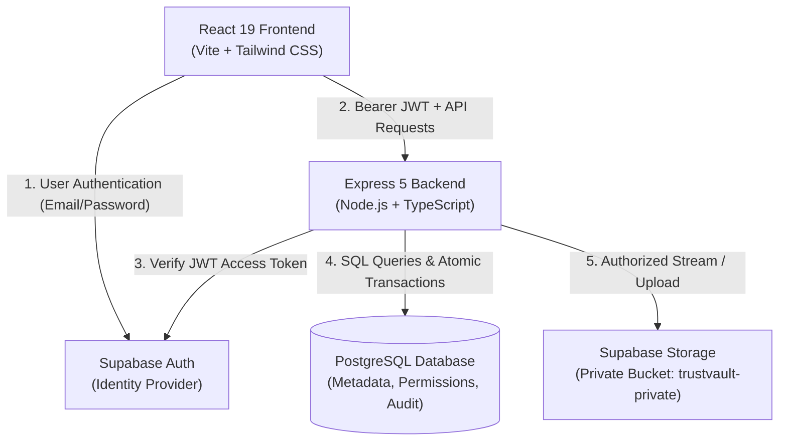
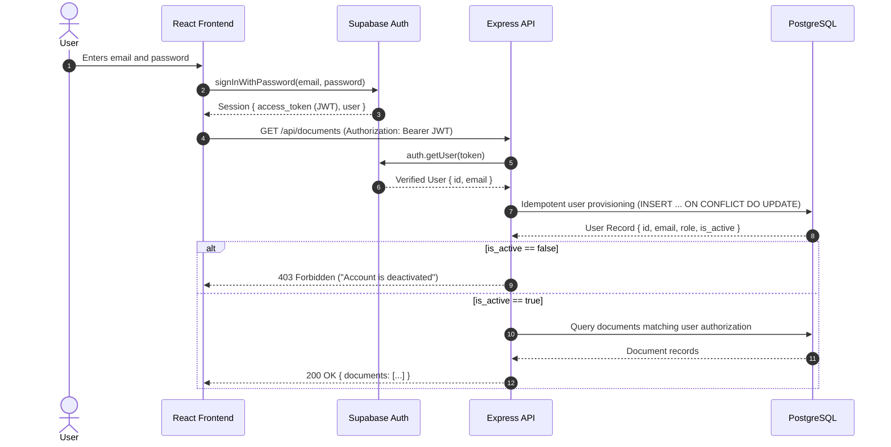
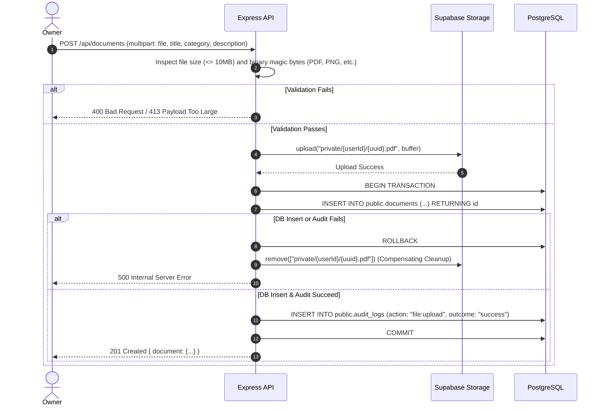
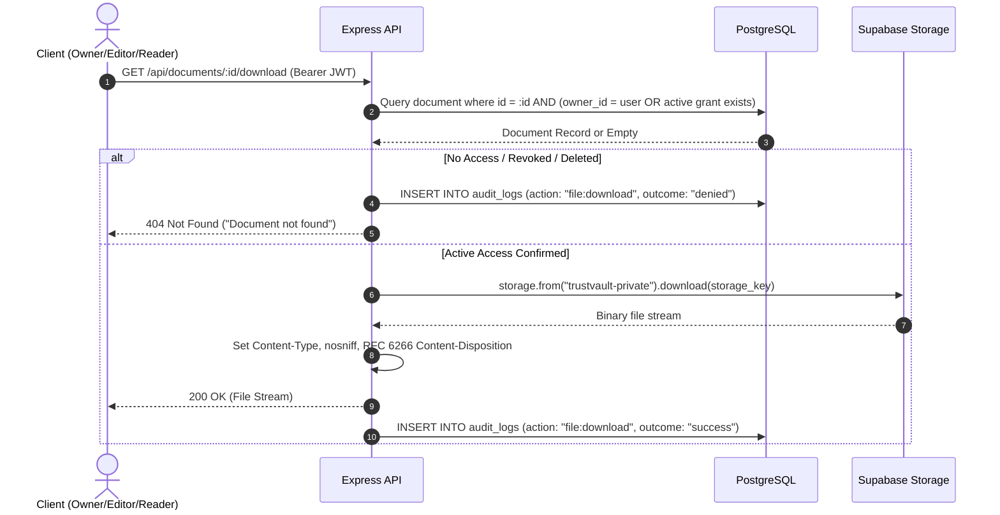
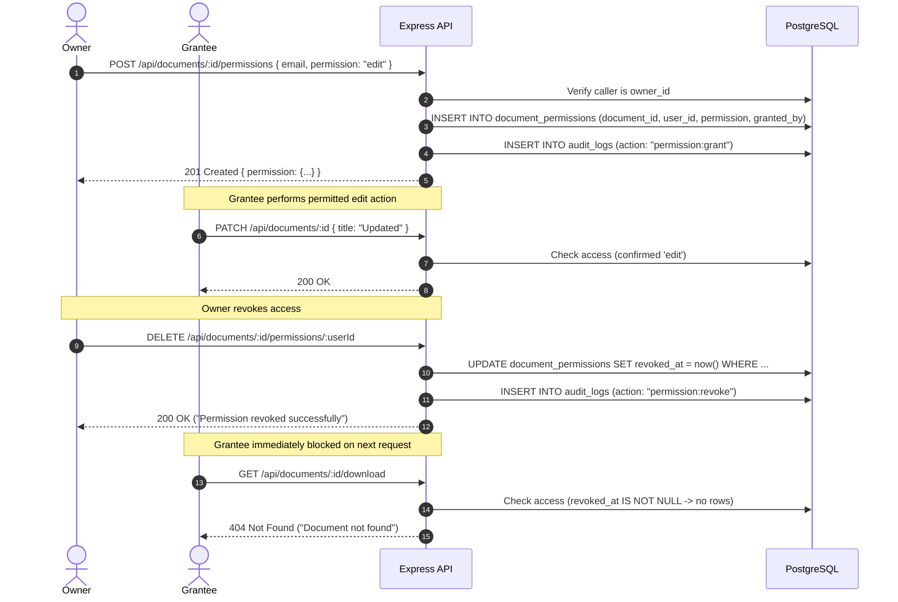

# TrustVault — Architecture & Security Specification

This document details the architectural design, component responsibilities, request pipelines, and security controls implemented in TrustVault.

---

## 1. System Overview & Component Responsibilities

TrustVault is structured into five distinct architectural layers:

### Component Responsibilities:

1. **Frontend (`apps/web`):**
   - Single Page Application (SPA) built with React 19, TypeScript, Vite, and Tailwind CSS.
   - Interacts directly with Supabase Auth (`@supabase/supabase-js`) solely for login, signup, password resets, and token persistence in the browser.
   - Communicates with the Express API for all document, download, sharing, and audit operations, attaching the user's verified Bearer JWT to every request.
   - Never holds service-role credentials or database connection strings.

2. **Backend API (`apps/api`):**
   - Express 5 REST API built in TypeScript with strict compile-time checking.
   - Stateless server layer acting as the single enforcement point for business logic, role-based authorization, metadata validation, and audit recording.
   - Validates incoming Supabase JWTs via `supabaseAdmin.auth.getUser(token)`.
   - Manages pooled database connections (`pg.Pool`) and coordinates file operations with private object storage.

3. **Supabase Auth (Identity Provider):**
   - Provides user authentication, password hashing (bcrypt/argon2), email confirmation tokens, and signed JWT issuance.
   - Does not enforce document-level authorization; document authorization is enforced exclusively by the backend API.

4. **PostgreSQL Database:**
   - Stores user profiles (`public.users`), document metadata (`public.documents`), permission grants (`public.document_permissions`), and audit logs (`public.audit_logs`).
   - Serves as the source of truth for ownership, permission levels, and immediate access revocations (`revoked_at`).

5. **Private Object Storage (`trustvault-private`):**
   - Supabase Storage bucket configured as strictly private.
   - Files are stored using unpredictable server-generated keys (`private/${owner_id}/${uuid}.${extension}`).
   - Public URLs and unauthenticated access are disallowed; all downloads are authorized and streamed server-side by the backend.

---

## 2. Authentication & Identity Pipeline

### Key Security Properties:
- **Client Identity Non-Trust:** The backend never trusts client-supplied user IDs, roles, or email headers. User identity is derived strictly from the cryptographically verified Supabase Auth JWT.
- **Role Elevation Prevention:** `public.users` provisioning uses `ON CONFLICT (id) DO UPDATE SET email = EXCLUDED.email, full_name = COALESCE(users.full_name, EXCLUDED.full_name)`. The existing `role` and `is_active` fields are never touched by user logins.
- **Deactivated Account Enforcement:** If `is_active` is set to `false`, the authentication middleware immediately halts execution and returns `403 Forbidden`, blocking access regardless of valid JWT status.

---

## 2.1 Dual-Layer Authorization: Global Roles vs. Document Permissions

TrustVault separates coarse-grained account capabilities from fine-grained per-document access:

### Layer 1: Global Account Roles (`public.users.role`)
Global roles determine tenant-wide capabilities and are enforced at the API route entry:
- **`admin`**: System administrator with access to tenant audit logs (`GET /api/admin/audit-logs`). Admins do **not** receive automatic read/download access to user documents without explicit sharing.
- **`owner`** *(default)*: Standard document creator. Can upload new documents, manage owned documents, and grant/revoke sharing permissions.
- **`viewer`**: Read-only collaborator. Strictly prevented from uploading documents (`POST /api/documents`), updating document metadata (`PATCH /api/documents/:id`), deleting documents (`DELETE /api/documents/:id`), or altering permissions (`/api/documents/:id/permissions/*`). Server-side checks reject violations with `403 Forbidden` and log denied audit events.
- **`user`** *(legacy)*: Backward-compatible alias for existing accounts; mapped directly to `owner` behavior.

### Layer 2: Document-Level Access Permissions (`document_permissions.permission`)
Regardless of global role, document access is evaluated per-document:
- **Document Creator (`documents.owner_id = user.id`)**: Full document CRUD, sharing governance, and audit history.
- **Editor Grantee (`permission = 'edit'`)**: Allowed to view, download, and update metadata (`title`, `category`, `description`). Cannot delete or manage permissions.
- **Reader Grantee (`permission = 'read'`)**: Read-only view and download access.

> **Principle of Least Privilege:** A global `owner` role does **not** grant access to documents owned by other users. Access to any document requires being its creator or having an active, unrevoked permission grant. Similarly, a global `viewer` cannot upload documents even if they have read permissions on several existing files.

---

## 3. Document Upload & Compensating Cleanup Flow

### Compensating Reconciliation Strategy:
1. When uploading a file, storage upload occurs first.
2. Metadata and the `file:upload` audit log are inserted within an atomic SQL transaction.
3. If the database insertion or audit logging encounters an unrecoverable failure, the backend checks the transaction state:
   - If **uncommitted**, the transaction is rolled back and the newly created storage object is deleted immediately to prevent storage leaks.
   - If **committed**, the document is soft-deleted to preserve referential audit integrity before cleaning storage.
   - If **uncertain**, the storage object is preserved to protect data integrity, and an alert is logged to stderr.

---

## 4. Secure File Download Flow

### Download Invariants:
1. **No Public Storage Access:** Files are never exposed via public bucket URLs. All requests pass through the Express backend.
2. **Real-time Authorization Check:** Permissions are evaluated dynamically on every download request against `public.document_permissions WHERE revoked_at IS NULL`.
3. **Non-Disclosure on Failure:** If access is unauthorized or revoked, the backend returns `404 Not Found` rather than `403 Forbidden`, preventing attackers from probing for the existence of confidential document IDs.
4. **Header Injection Defense:** Filenames in `Content-Disposition` headers are sanitized to strip directory traversal (`..`, `/`, `\`), control characters, CR, and LF, and encoded according to RFC 6266 and RFC 5987.

---

## 5. Sharing & Immediate Revocation Flow

---

## 6. Audit Logging Architecture

Audit logging is implemented in `apps/api/src/audit.ts` through the `recordAuditLog` utility.

### Consistency Policy:
1. **Transactional Mutations:**
   - When a state-changing mutation is executed (document creation, metadata update, document deletion, permission grant, permission update, permission revocation), the database client connection (`client`) is passed to `recordAuditLog`.
   - The audit log entry is written inside the **same SQL transaction**.
   - If audit insertion fails, the entire transaction is rolled back, guaranteeing that no state change persists without its audit trail.
2. **Non-Transactional & Denied Events:**
   - When recording non-mutating events (document read, file download, access denied events), `pool.query` is used independently.
   - Any failure during standalone audit logging is trapped safely to prevent service disruption while logging diagnostics to stderr.
3. **Audit Information Scope:**
   - Audit records track: `actor_id`, `document_id`, `action`, `outcome` (`success`, `denied`, `failure`), `details` (JSON payload with updated fields, target users, or error reasons), and `created_at`.
   - Sensitive credentials, passwords, JWT tokens, and storage credentials are never included in audit payloads.
   - *Security Note:* Audit logs in PostgreSQL provide an auditable operational trail; they are not presented as cryptographically signed or tamperproof blockchain ledgers.

---

## 7. Security Boundaries & Trust Assumptions

| Domain | Control / Implementation | Residual Risk / Known Limitation |
|---|---|---|
| **Identity** | Supabase Auth handles credential hashing, verification, and JWT signing. | Backend relies on Supabase service availability and secret key security. |
| **Authorization** | Server-side validation on every request via PostgreSQL queries. | The backend connects to PostgreSQL as the `postgres` user, bypassing Row-Level Security (RLS). Authorization relies on Express middleware correctness. |
| **File Storage** | Private bucket, unpredictable server keys, streamed downloads with `nosniff`. | Revocation blocks future downloads; files already saved to a client device cannot be recalled remotely. |
| **Input Validation** | 10 MB limit, MIME type whitelist, binary magic-byte checks, UTF-8 text decoding. | Magic-byte checks ensure file format header conformance; they do not replace dedicated anti-malware/antivirus scanning. |
| **Rate Limiting** | `express-rate-limit` enforces 100 requests per 15 minutes per IP. | In-memory store; limits apply per process instance. Distributed deployments require Redis backing. |
| **Audit Logs** | Transactional integrity for all mutations; strict admin restriction for global logs. | Logs are stored in a standard relational database table, not a write-once tamperproof ledger. |

> For the comprehensive 13-threat register (T1–T13), verification evidence, and pre-deployment security checklist, refer to [THREATS.md](file:///c:/Users/tullu/OneDrive/Desktop/College/trustvault/THREATS.md). For AI development and review records, see [PROMPTS.md](file:///c:/Users/tullu/OneDrive/Desktop/College/trustvault/PROMPTS.md).

